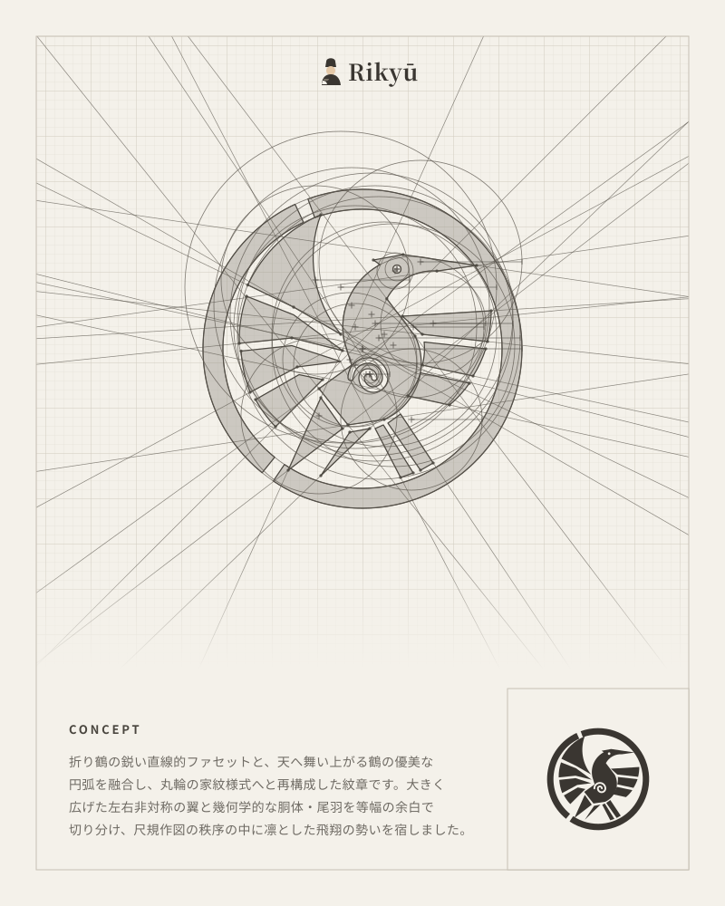
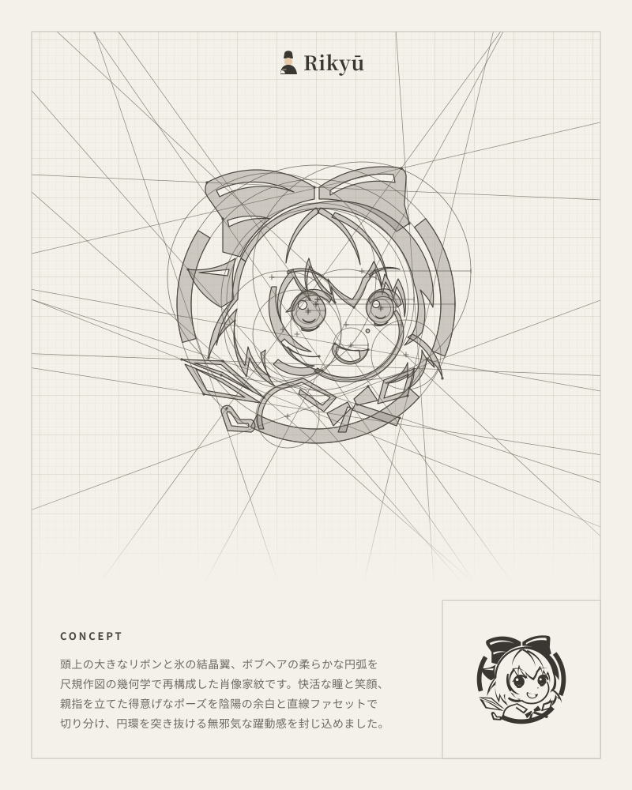

<div align="center">

# Rikyu Crest Blueprint · 利休纹章蓝图

**把任意图像 / 照片 / 雕塑 / 动物 / 设计概念，转译成日式几何家纹（Kamon）与「尺规作图」蓝图海报 —— 纯 SVG，可无限缩放**

`Agent Skill` · `Pure SVG` · `800 × 1000 竖版海报` · `零运行时依赖`

> An Agent Skill that turns any image or design concept into a Rikyu-style Japanese kamon crest, presented as a compass-and-straightedge construction blueprint poster in pure SVG.

</div>

<p align="center">
  
  
</p>

<p align="center"><sub>左：折鹤家纹（Origami Crane Kamon）　·　右：角色头像家纹（Avatar Kamon）　—　均为技能输出示例</sub></p>

---

## 项目简介

这是一个**可复用的 Agent 技能包**（遵循 `SKILL.md` 技能约定，适用于 Claude Code、DeepSeek Harness 及任何支持该约定的 Agent）：

- **输入**：一张上传的参考图（照片、雕塑、动物、角色头像、海报），或一段文字设计概念；
- **输出**：一张 800 × 1000 的竖版 SVG 海报。海报同时包含四层信息：

  1. **中央半透明纹章**：由 4–8 块高对比扁平几何色块构成的极简剪影，色块之间以 6–10px 等宽负空间切分；
  2. **同步尺规构造**：与剪影轮廓共享同一套数学定义的构造圆（含圆心十字准星、半径引线）与延伸切线/割线射线，被裁切在内框之中；
  3. **渐隐毫米网格**：10px / 50px 双层网格，在上方蓝图区清晰、在概念区之前柔和淡出；
  4. **编辑式版面**：顶部 Rikyū 品牌标（茶人剪影 + 衬线字）、左下 `CONCEPT` 设计说明、右下角实心成品纹章预览。

所有几何都由同一份「图元构造注册表」推导，纹章轮廓与构造线**共用同一组圆心、半径与端点**——因此构造圆是真正与轮廓相切/相交的，而不是随便画的装饰圆。

## 技能能做什么

| 场景 | 示例提问 |
| --- | --- |
| 图片 → 家纹蓝图 | 「把这张狮子照片转成利休风家纹蓝图」 |
| 图片 → SVG 几何速写 | 「用尺规作图风格重绘这个雕像」 |
| 概念 → 纹章设计 | 「设计一个凤凰主题的日式家纹，要带作图辅助线」 |
| 头像 → 肖像家纹 | 「把这张角色头像做成几何家纹海报」 |
| 风格复刻 | 「复刻一张圆环包围式家纹蓝图海报」 |

技能内置两种构图原型，会自动按主体形态选择：

- **圆环家纹（Enclosed Circular Kamon）**：主体被外圈圆环（r≈165–185）包围，适合有翼、盘旋、旋转类母题；
- **独立纹章（Freestanding Heraldic Crest）**：主体落在一条水平基线上，沿主导对角轴展开，适合站立猛兽、雕塑、建筑形态。

## 目录结构

```text
rikyu-crest-blueprint/
├── SKILL.md                                  # 技能主文件：触发条件 + 5 步工作流 + 常见坑
├── README.md                                 # 本文件（面向人类读者）
├── assets/
│   ├── rikyu_origami_crane_kamon.svg         # 参考海报：折鹤家纹（完整示范所有图层）
│   └── rikyu_cirno_avatar_kamon.svg          # 示例海报：角色头像家纹
└── scripts/
    └── build_crane_svg.py                    # 参考生成器：图元计算 → 精确 SVG 弧线
```

## 快速开始

### 1. 作为 Agent Skill 安装

```bash
git clone https://github.com/lzytttttt/rikyu-crest-blueprint.git

# Claude Code / 兼容 SKILL.md 约定的 Agent（用户级技能目录）
mkdir -p ~/.claude/skills
cp -r rikyu-crest-blueprint ~/.claude/skills/
```

Windows（PowerShell）：

```powershell
git clone https://github.com/lzytttttt/rikyu-crest-blueprint.git
New-Item -ItemType Directory -Force "$env:USERPROFILE\.claude\skills" | Out-Null
Copy-Item -Recurse .\rikyu-crest-blueprint "$env:USERPROFILE\.claude\skills\rikyu-crest-blueprint"
```

> 如果你的 Harness 使用项目级技能目录，把整个文件夹放到 `<workspace>/skills/rikyu-crest-blueprint` 即可；
> 也可以直接把 `SKILL.md` 的内容作为系统提示词 / 技能描述交给 Agent。

### 2. 触发技能

上传参考图后直接描述意图即可，例如：

```text
把这张照片转成 Rikyu 风格的几何家纹蓝图海报
```

Agent 会读取 `SKILL.md` 中的 5 步流程，按图元注册表计算弧线端点，输出可直接落盘的 `.svg`。

### 3. 本地生成参考示例（可选）

```bash
python scripts/build_crane_svg.py
# -> output/rikyu_origami_crane_kamon.svg
```

仅依赖 Python 3 标准库（`math` / `os`），无需任何第三方包。生成结果与 `assets/` 中的参考海报几何一致。

### 4. 预览与再编辑

- 浏览器直接打开 SVG 即可预览（双击或拖入 Chrome / Edge / Safari）；
- 可导入 Figma、Illustrator、Inkscape 继续编辑；
- 因为全部是矢量，任意放大到印刷尺寸都不会失真。

## 工作流程（SKILL.md 摘要）

1. **拆解图元**：选构图原型 → 把照片降维成 4–8 块扁平几何色块 → 建立「图元构造注册表」（记录每个圆的 `cx, cy, r` 与每条线的 `x1, y1, x2, y2`）。
2. **搭画布与网格**：`viewBox="0 0 800 1000"`，10px/50px 双层毫米网格 + 纵向渐隐遮罩。
3. **构建可复用纹章**：所有轮廓写进 `<defs><g id="crest-shape">`，用 `<use>` 实例化两次（中央半透明版 + 右下角实心版），保证几何零漂移。
4. **渲染同步构造线**：按注册表绘制 14–24 个构造圆（r≈10–240）与 12–20 条延伸射线（沿线方向 ±1200 单位投影），统一裁切到蓝图内框。
5. **编排版面**：外框、页眉、`CONCEPT` 概念文本（跟随用户语言：中文 / 日文 / 英文）、右下角成品预览框。

## 设计规范

| 项目 | 规格 |
| --- | --- |
| 画布 | `viewBox="0 0 800 1000"`（竖版海报） |
| 蓝图内框 | `x=40 y=40 w=720 h=720`（构造线裁剪区） |
| 外框 | `x=40 y=40 w=720 h=920`，发丝线 1px |
| 毫米网格 | 10px 细网格 + 50px 主网格，纵向 `y=640→750` 渐隐 |
| 构造圆 | 14–24 个，半径 10–240，含 7px 圆心十字准星与半径引线 |
| 延伸射线 | 12–20 条，沿线方向 ±1200 单位投影，超出内框即裁切 |
| 负空间 | 色块间 6–10px 等宽留白（全尺寸坐标空间 `[-185, 185]` 内） |
| 成品预览 | 右下角 `200 × 200` 内嵌框，纹章中心 `(660, 860)`，缩放 `0.32` |

**配色 token**

| 用途 | 色值 | 说明 |
| --- | --- | --- |
| 背景纸 | `#F4F1EA` | 米白纸感 |
| 10px 细网格 | `#E2DDD3` | `stroke-width="0.6"` |
| 50px 主网格 | `#D2CCC0` | `stroke-width="0.9"` |
| 外框 / 预览框 | `#C6C0B4` | `stroke-width="1"` |
| 半透明纹章 | `#8C877E` | `fill-opacity="0.38"`，描边 `#4A463F` `1.25` |
| 构造圆 / 射线 | `#5C574F` | `stroke-width="0.75"`，`stroke-opacity="0.72"` |
| 实心成品 / 页眉标 | `#3A3631` | 成品纹章与品牌字 |
| 概念正文 | `#6E6A63` | 设计说明文字 |

## 常见坑（Gotchas）

- **不要画装饰性圆**：每个构造圆、每条射线都必须与剪影的真实曲线/边相切或相交，端点必须由 `(cx, cy, r)` 精确推导，否则「尺规作图」的叙事会露馅。
- **不要在透明组里用纸色描边掏负空间**：给组加 `fill-opacity="0.38"` 后，`#F4F1EA` 描边会浮在网格之上变成脏线。请改用独立的闭合 `<path>` 色块、`fill-rule="evenodd"` 复合路径或 SVG `<mask>` 做镂空。
- **负空间要留够**：保持 6–10px 的等宽间隙，保证缩小到右下角 `0.32` 预览时仍不糊成一块实心；同时头部与尾部周围留出足够留白，让图形读起来像「纹章」而不是「风车」。

## 环境与兼容性

- **输出**：单个 `.svg` 文件，无位图、无外部字体、无网络请求（文本使用系统字体回退栈）；
- **生成**：任何支持写 SVG 的 Agent 均可运行技能；参考脚本仅需 Python 3；
- **渲染**：现代浏览器 / Figma / Illustrator / Inkscape 均可打开。

## 说明

本仓库暂未声明开源许可证（No license declared yet）。如需复用、二次分发或商业使用，请先联系仓库作者。

## 致谢

灵感来自千利休（Rikyū）的侘寂美学、日本家纹（Kamon）的圆形构图传统，以及建筑制图中的尺规作图（compass-and-straightedge construction）语言。
